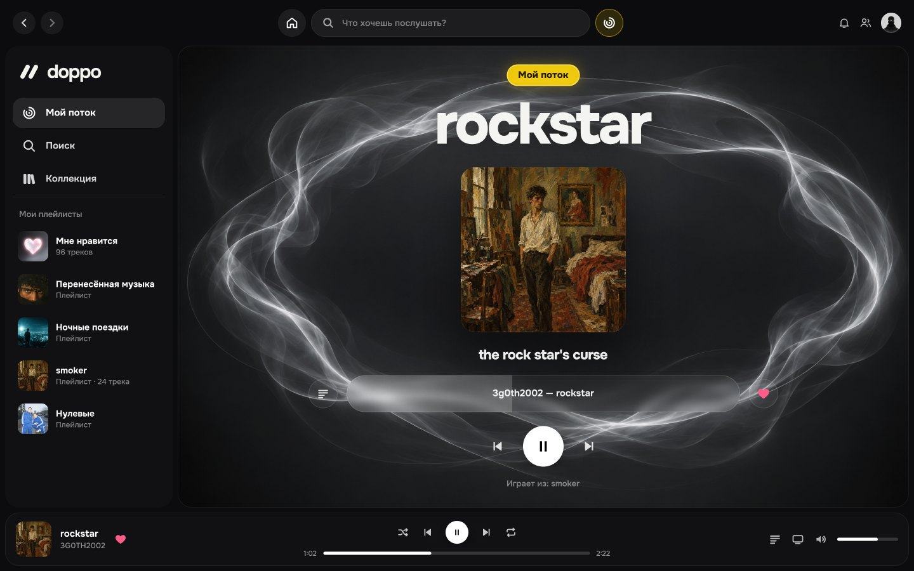

# doppo for Spotify

[Русская версия](README.md)

A [Spicetify](https://github.com/spicetify/cli) theme + app that turns Spotify into **doppo**:
dark graphite, the bold [Onest](https://fonts.google.com/specimen/Onest) typeface, big rounded corners,
white buttons, a yellow accent — plus **My Flow**, an endless taste radio, karaoke-style lyrics
and a redesigned collection.

The interface language follows your Spotify language: Russian Spotify → Russian doppo, anything else → English.



## Install with one command

You need the regular Spotify desktop app from spotify.com (not the Microsoft Store version) and
[Spicetify](https://spicetify.app/docs/getting-started).

**macOS / Linux** — in Terminal:

```bash
curl -fsSL https://raw.githubusercontent.com/kikobin/doppo/main/remote-install.sh | bash
```

**Windows** — in PowerShell:

```powershell
iwr -useb https://raw.githubusercontent.com/kikobin/doppo/main/remote-install.ps1 | iex
```

Run the same command again to update. No Spicetify yet? Install it first
(`curl -fsSL https://raw.githubusercontent.com/spicetify/cli/main/install.sh | sh` on macOS/Linux,
`iwr -useb https://raw.githubusercontent.com/spicetify/cli/main/install.ps1 | iex` on Windows),
restart the terminal and run the command above.

## Nothing from Spotify disappears

Home, search, your library, playlists, albums, artists, the player bar, queue, devices, volume,
Now Playing View, friends, notifications, settings and native lyrics all stay where they are and keep working.
doppo only **restyles** them and **adds** new things next to them.

## What's inside

| Part | Path | Spicetify type | What it does |
|---|---|---|---|
| **Doppo theme** | `Themes/Doppo/` | theme | CSS only. Restyles the whole native UI. Hides nothing. |
| **My Flow app** | `CustomApps/doppo/` | custom app | Pages `/doppo` (flow), `/doppo/lyrics`, `/doppo/collection`, `/doppo/liked`. Spotify adds its icon to the top bar next to Home. |
| **Extensions** | `CustomApps/doppo/extension.js`, `flowengine.js` | extensions bundled with the app | doppo navigation above Your Library, a My Flow button in the player, “Start flow from this track” in the track menu, a **doppo** settings submenu in the profile menu, and the flow engine. |

### My Flow — an endless radio tuned to you

Press **Start My Flow** or pick a mode at the bottom of the screen:

| Mode | What plays |
|---|---|
| **Vibe** | new music close to what you like right now |
| **Favorites** | your liked songs, shuffled |
| **Discover** | only songs you haven't liked yet |

- Recommendations come from Spotify's own track radio; seeds are your likes and the tracks that worked this session.
- It learns: listened to the end or liked → the next batch grows from that; skipped quickly → that artist shows up less.
- 👎 next to the track bar skips the song and never suggests it again (an artist is dropped after two dislikes).
- Endless: when the queue runs low it adds a fresh, non-repeating batch. Works in the background too.
- Play something else and the flow pauses; restart it from the badge.
- **Up next in flow** in the corner. Reset the flow's taste: profile menu → doppo → Reset flow taste.

### Lyrics

- Musixmatch (word-synced), Spotify and LRCLIB are queried in parallel; the best result wins and the next track is prefetched.
- Karaoke: each word fills in time with the song; lines glide in a soft wave; animated dots during instrumental breaks.
- Background: blurred cover + smoke in the track's colours (Canvas video can be enabled in settings).
- **Stage** mode (`F` or the corner icon on hover) — just huge lyrics. Lyrics early or late? Use `[` and `]`.
- Spotify's lyrics button (from any tab) and the “Lyrics preview” card open doppo lyrics; press again or `Esc` to go back.

### My Collection and Liked Songs

- doppo-styled pages built from your real library: a Liked Songs card, recently liked tracks, all playlists (folders included).
- The full Liked Songs list — every track, no limits — with search, sorting, shuffle, a working ♡, **Now playing** jump and an equalizer on the playing track.
- Spotify's own Liked Songs page opens in doppo style; **Open in Spotify** leads to the original.

### Settings (profile menu → doppo)

| Item | Default |
|---|---|
| doppo navigation block | on |
| My Flow button in player | on |
| Smoke in My Flow | on |
| Canvas video background | off |
| doppo lyrics instead of native | on |
| doppo Liked Songs page | on |
| Open My Flow on start | off |

To force a language: run `localStorage.setItem("doppo:lang", "en")` (or `"ru"`) in Spotify DevTools and restart Spotify.

## Other ways to install

**From a downloaded folder:** download the [archive](https://github.com/kikobin/doppo/archive/refs/heads/main.zip), unzip and run
`bash install.sh` (macOS/Linux) or `powershell -ExecutionPolicy Bypass -File .\install.ps1` (Windows).

**Spicetify Marketplace:** the theme installs from the Marketplace in one click, but the Marketplace can't install
custom apps — for My Flow, lyrics and the collection use the command above.

## Uninstall

```bash
./uninstall.sh
```

```powershell
powershell -ExecutionPolicy Bypass -File .\uninstall.ps1
```

`spicetify restore` returns Spotify to stock.

## Feedback

Found a bug or have an idea? [Open an issue](https://github.com/kikobin/doppo/issues/new/choose).

## License

[MIT](LICENSE) © kikobin. doppo is not affiliated with Spotify. Spicetify modifies the Spotify client — use at your own risk.
