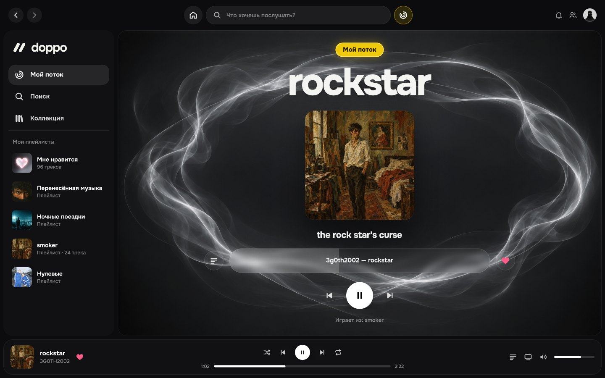
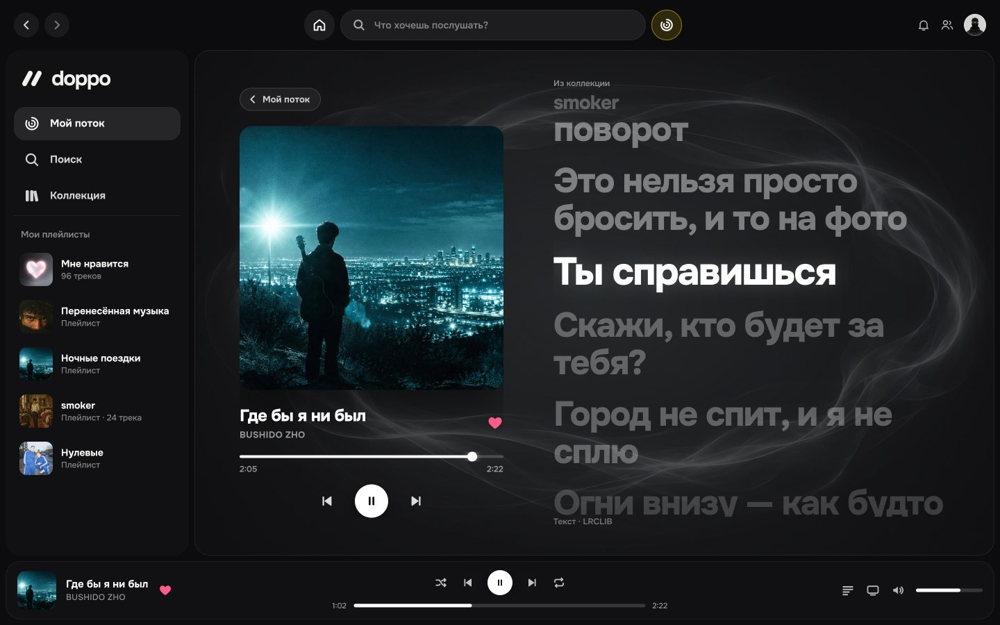
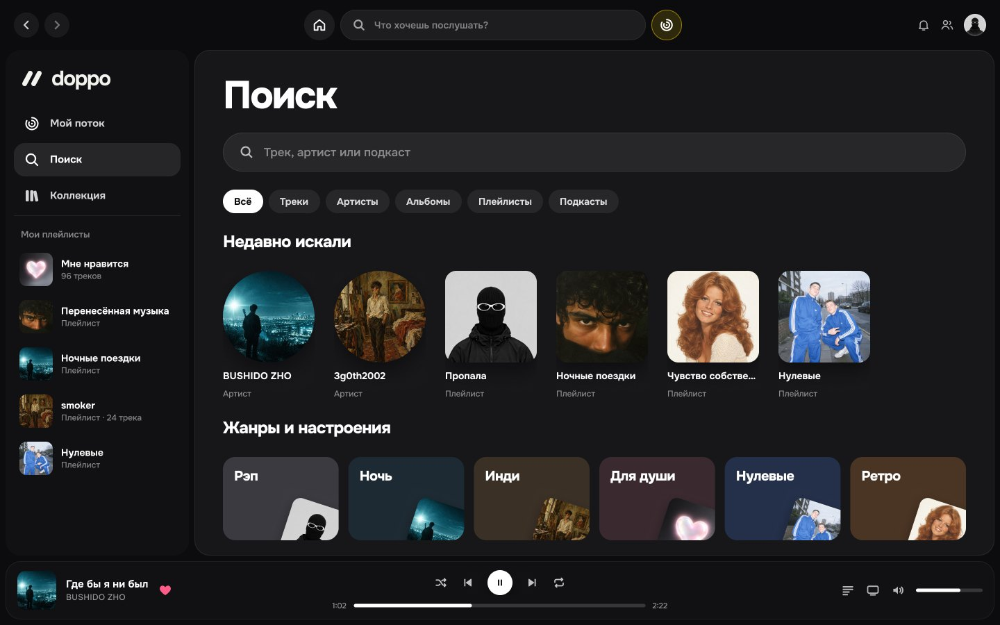
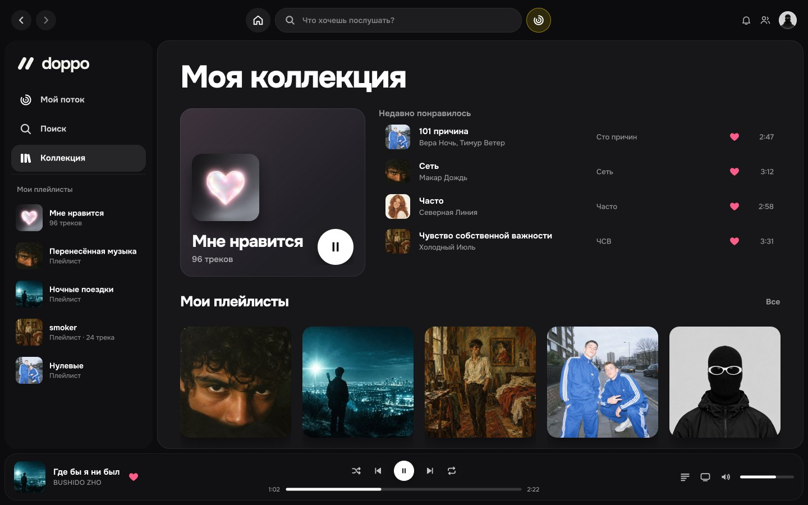
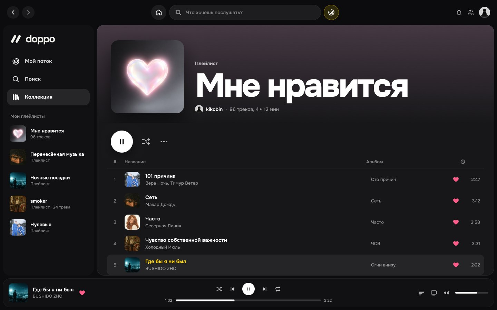
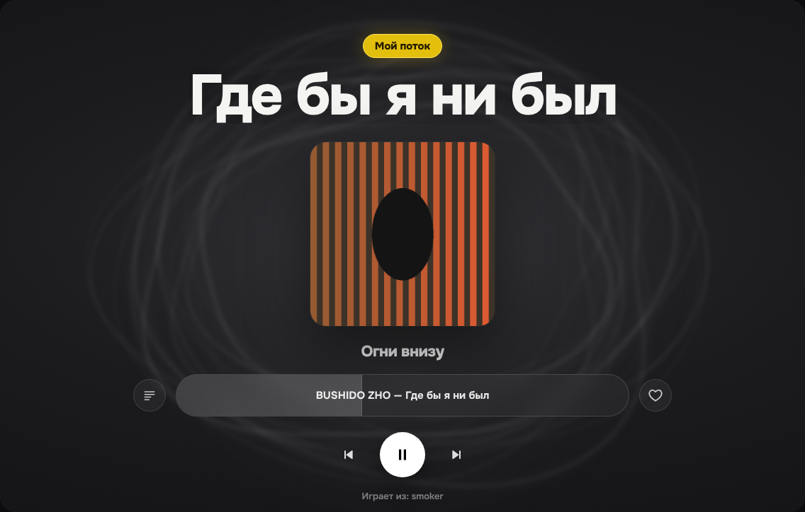
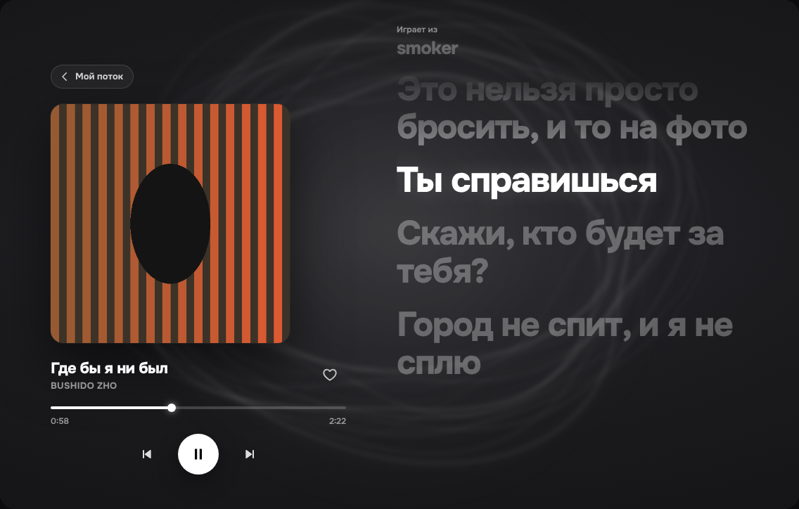
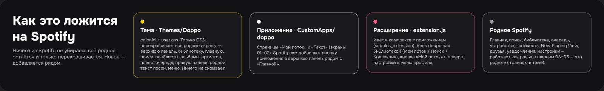

# doppo для Spotify

[English version](README.en.md)

Набор для [Spicetify](https://github.com/spicetify/cli), который делает Spotify похожим на doppo:
тёмный графит, жирный шрифт [Onest](https://fonts.google.com/specimen/Onest), большие скругления,
белые кнопки, жёлтый акцент — и отдельный экран **«Мой поток»** с дымкой вокруг обложки и крупным текстом песни.

Язык интерфейса — как у Spotify: русский Spotify → русский doppo, любой другой → английский.



## Установка в одну команду

Нужен обычный Spotify с сайта spotify.com (не из Microsoft Store) и [Spicetify](https://spicetify.app/docs/getting-started).

**macOS / Linux** — в Терминале:

```bash
curl -fsSL https://raw.githubusercontent.com/kikobin/doppo/main/remote-install.sh | bash
```

**Windows** — в PowerShell:

```powershell
iwr -useb https://raw.githubusercontent.com/kikobin/doppo/main/remote-install.ps1 | iex
```

Этой же командой doppo обновляется. Нет Spicetify? Сначала поставь его
(`curl -fsSL https://raw.githubusercontent.com/spicetify/cli/main/install.sh | sh` на Mac/Linux,
`iwr -useb https://raw.githubusercontent.com/spicetify/cli/main/install.ps1 | iex` на Windows),
перезапусти терминал — и выполни команду выше.

| Текст песни | Поиск |
|---|---|
|  |  |
| **Коллекция** | **Плейлист «Мне нравится»** |
|  |  |

Это макеты из [Figma](https://www.figma.com/design/H8nocFdmbCZ9735mNIjwCg/Untitled). Они уже разложены
по настоящей раскладке Spotify: сверху родная панель с «Главной» и поиском, слева медиатека, снизу родной плеер.
Экраны «Мой поток» и «Текст» — это приложение doppo. «Поиск», «Коллекция» и плейлист — родные страницы
Spotify в теме doppo.

Так выглядит живой рендер кода приложения (проверка в браузере с имитацией Spotify):

| Мой поток | Текст песни |
|---|---|
|  |  |

## Главный принцип: из Spotify ничего не пропадает

Всё родное остаётся на своих местах и работает как раньше: главная, поиск, медиатека, плейлисты, альбомы,
артисты, нижний плеер, очередь, устройства, громкость, Now Playing View, друзья, уведомления, настройки,
родной экран текста. doppo только **перекрашивает** это и **добавляет** новое рядом.

## Из чего состоит

По документации Spicetify есть три вида дополнений: тема, расширение и кастомное приложение.
doppo использует все три — каждое для своей задачи.

| Часть | Где лежит | Тип Spicetify | Что делает |
|---|---|---|---|
| **Тема Doppo** | `Themes/Doppo/` (`color.ini`, `user.css`) | тема | Только CSS. Перекрашивает весь родной интерфейс: верхнюю панель, медиатеку, списки треков, карточки, плитки поиска, нижний плеер, правую панель, родной текст песен, меню. Ничего не скрывает. |
| **Приложение «Мой поток»** | `CustomApps/doppo/` (`index.js`, `style.css`, `manifest.json`) | кастомное приложение | Отдельные страницы `/doppo` (поток) и `/doppo/lyrics` (текст). Spotify сам добавляет иконку приложения в верхнюю панель рядом с «Главной». |
| **Расширения** | `CustomApps/doppo/extension.js`, `flowengine.js` | расширение (идёт в комплекте с приложением через `subfiles_extension`) | Запускается вместе со Spotify. Добавляет блок doppo над «Моей медиатекой» (Мой поток / Поиск / Коллекция), кнопку «Мой поток» в нижнем плеере, пункт «Запустить поток с этого трека» в меню трека и подменю настроек **doppo** в меню профиля. |

Части не зависят друг от друга: можно поставить только тему, а можно только приложение.



### «Мой поток» — как «Моя волна»

Экран в стиле doppo: жёлтая плашка, огромное название трека, обложка в дымке, полоса «артист — трек»
(наведи — видно время, клик — перемотка), 👎 и ♡ по бокам, управление и текст песни.
Всё идёт через штатный плеер Spotify, так что очередь и устройства остаются синхронными.

Бесконечный поток под твой вкус. Нажми «Запустить мой поток» (или выбери режим внизу экрана):

| Режим | Что играет |
|---|---|
| **Под вайб** | новые треки рядом с тем, что тебе нравится прямо сейчас |
| **Любимое** | твои лайки вперемешку |
| **Незнакомое** | только то, чего нет в твоих лайках |

- Рекомендации — родное «Радио по треку» Spotify; семена — твои лайки и удачные треки сессии.
- Поток учится: дослушал или лайкнул — следующая порция строится от этого; быстро пропустил — исполнитель реже.
- 👎 слева от полосы трека — пропустить и больше не предлагать (исполнитель уходит после двух дизлайков).
- Бесконечный: когда очередь кончается, поток сам добавляет новую порцию без повторов. Работает фоном, даже если экран закрыт.
- Включил что-то своё — поток встаёт на паузу; вернуться — кнопкой на плашке.
- В углу — «Дальше в потоке». Сбросить вкус — меню профиля → doppo → «Сбросить вкус потока».
- В меню трека (ПКМ) — «Запустить поток с этого трека».

### Текст песни doppo

- Три источника параллельно: **Musixmatch** (синхронизация по словам), **Spotify**, **LRCLIB**. Берётся лучший, текст следующего трека грузится заранее.
- Караоке: каждое слово заливается белым в такт; строки едут «волной», дальние размыты; в проигрышах — «дышащие» точки.
- Фон — размытая обложка + дымка в цветах трека (видео **Canvas** трека можно включить в настройках).
- **Сцена** (`F` или иконка в углу при наведении) — только огромный текст по центру. Если текст спешит или опаздывает — `[` и `]`.
- Колесо мыши — листать вручную, через 3,5 с текст сам вернётся к текущей строке.
- Кнопка текста в плеере Spotify (с любой вкладки) и карточка «Предпросмотр текста» открывают текст doppo; повторное нажатие или `Esc` — назад, туда, откуда пришёл. Родной экран можно вернуть в настройках.

### Удобство

- Исполнитель, альбом и «Играет из» везде кликабельны и ведут на свои страницы.
- Полоса трека при наведении показывает время, куда перемотаешь.
- Обложка в потоке при наведении подсказывает: по клику — текст.
- Кнопки Play откликаются сразу, не дожидаясь Spotify.
- Правая панель Spotify (Now Playing View) — в стиле doppo: спокойный фон, одинаковые тёмные карточки, «Предпросмотр текста» открывает текст doppo.

### Моя коллекция и «Мне нравится»

Свои страницы в стиле doppo (`/doppo/collection`, `/doppo/liked`) на твоих настоящих данных:
карточка «Мне нравится», недавние лайки, все плейлисты (включая папки); полный список лайков — все треки,
без ограничений — с поиском, перемешиванием, сердечком «убрать/вернуть» и эквалайзером у играющего трека.
Сортировка (дата, название, исполнитель, альбом, длительность) и кнопка «К играющему». Список рисуется порциями, так что тысячи лайков не тормозят. Родная страница «Любимые треки» открывается
в стиле doppo, кнопка «Открыть в Spotify» ведёт на оригинал.

### Настройки (меню профиля → doppo)

| Пункт | По умолчанию |
|---|---|
| Блок навигации doppo | вкл |
| Кнопка «Мой поток» в плеере | вкл |
| Дымка в «Моём потоке» | вкл |
| Видео Canvas на фоне | выкл |
| Текст doppo вместо родного | вкл |
| «Мне нравится» в стиле doppo | вкл |
| Открывать «Мой поток» при запуске | выкл |

## Другие способы установки

### Из скачанной папки

Скачай [архив](https://github.com/kikobin/doppo/archive/refs/heads/main.zip), распакуй и запусти установщик из папки:

```bash
bash install.sh
```

```powershell
powershell -ExecutionPolicy Bypass -File .\install.ps1
```

Установщик копирует тему и приложение в папку Spicetify, включает их и делает `spicetify apply`
(если Spotify обновился — сам делает `spicetify backup apply`). Другие темы и расширения не трогает.

### Вручную

Скопируй `Themes/Doppo` в `Themes`, а `CustomApps/doppo` — в `CustomApps` папки Spicetify. Затем:

```bash
spicetify config current_theme Doppo color_scheme doppo inject_css 1 replace_colors 1
```

```bash
spicetify config custom_apps doppo
```

```bash
spicetify apply
```

### Через Marketplace

doppo есть в Spicetify Marketplace. Тема ставится оттуда в один клик, но **приложение** («Мой поток»,
текст, коллекция) Marketplace ставить не умеет — для него нужна команда из начала README.

## Настройка внешнего вида

- **Светлее фон** — вторая палитра. Включается так: `spicetify config color_scheme fog`, затем `spicetify apply`.
- **Акцент / радиусы / шрифт** — переменные `--doppo-accent`, `--doppo-radius`, `--doppo-font` в начале `Themes/Doppo/user.css`.

## Удаление

Windows:

```powershell
powershell -ExecutionPolicy Bypass -File .\uninstall.ps1
```

macOS / Linux:

```bash
./uninstall.sh
```

Чтобы полностью вернуть чистый Spotify без Spicetify:

```bash
spicetify restore
```

## Как это устроено технически

- Spotify прячет настоящие имена CSS-классов за хэшами. Spicetify при `apply` подставляет стабильные имена
  (`main-nowPlayingBar-…`, `main-yourLibraryX-…`, `lyrics-lyricsContent-…` и т.д.). Тема опирается на них,
  на `data-testid` и на переменные дизайн-системы Encore, поэтому переживает большинство обновлений клиента.
- `style.css` приложения Spicetify подключает автоматически вместе со страницей приложения.
- Расширение и приложение общаются через `localStorage["doppo:settings"]` — так рекомендует документация Spicetify.
- Шрифт подгружается с Google Fonts, тексты песен — с lrclib.net.

Если после крупного обновления Spotify какая-то мелочь в теме слетела (радиус, цвет), это чинится
правкой одного селектора в `user.css`. Функции Spotify от темы не зависят.

## Обратная связь

Нашёл баг или есть идея — [открой issue](https://github.com/kikobin/doppo/issues/new/choose).

## Лицензия

[MIT](LICENSE) © kikobin. doppo не связан со Spotify. Spicetify модифицирует клиент Spotify — используешь на свой страх и риск.
